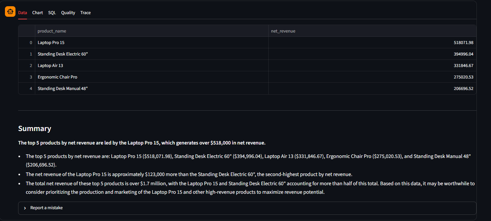
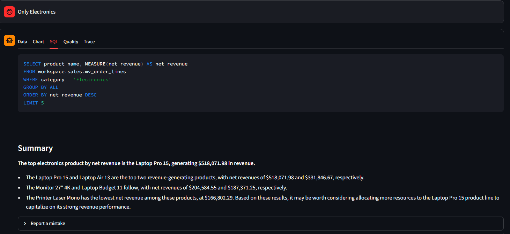
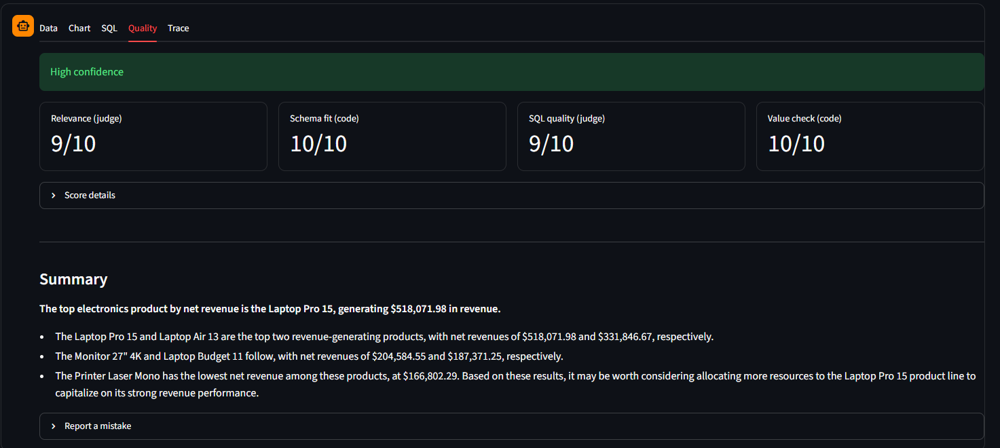

# Plumbline

**Natural-language BI that checks its own answers.** Ask in plain English; get governed SQL, the result, and
an honest verdict on whether to trust it, on Databricks.

*A plumb line is the builder's tool for checking that something is true.*

Plumbline turns plain-English business questions into Spark SQL over **Unity Catalog metric views**, so
"revenue" or "headcount" means exactly one thing everywhere. Every query passes **code-verified guardrails**
(a character-level SQL scanner, not prompt politeness), is scored by an **independent judge model** from a
different model family than the generator, and the whole system is measured by an **eval harness benchmarked
against Databricks Genie** on the same questions and the same data (see [Benchmark](#benchmark-vs-databricks-genie)).

Built for Databricks Free Edition: serverless compute only, one SQL warehouse, Foundation Model APIs.

## Demo

| Answer | Generated SQL (follow-up) | Quality verdict |
| --- | --- | --- |
|  |  |  |

More in [`demo/`](demo/). The live app runs on Databricks Free Edition behind a workspace sign-in; it can be started
on request for a walkthrough.

## How it works

```
question -> prompt (metric view context + live schema + enum values + saved corrections)
         -> generator model (Foundation Model API)
         -> guardrails (read-only SELECT, no system/app schemas, comment/literal aware)
         -> SQL warehouse (one automatic repair attempt on error)
         -> scoring (schema + value compliance computed in code, metric-view misuse check)
         -> judge model (relevance and SQL quality, different model family)
         -> verdict: GOOD / NEEDS REVIEW / RISKY / UNSCORED, plus a short summary
```

* `app/plumbline/pipeline.py` is the only orchestration; the Streamlit app and the eval harness both call it,
  so the accuracy the eval reports is the accuracy users get.
* The **semantic registry** (`app/semantic/*.yaml`, 10 metric views) is the single source of truth: notebook 04
  renders it into `CREATE VIEW ... WITH METRICS`, and the prompt builder renders the same files into model context.
* Pure modules (`guardrails`, `parsing`, `scoring`, `semantic`, `prompts`, `eval/compare`) import with only the
  standard library, pyyaml and pandas, so the tests run offline for free.

## Data

Three synthetic domains seeded deterministically from a fixed `as_of_date` (no `current_date()` in the seed code,
so the data and every date-relative answer are reproducible):

| Schema | Content |
| --- | --- |
| `sales` | customers, products, stores, channels, promotions, orders, order items, returns, inventory |
| `hr` | departments, employees, payroll, performance reviews |
| `finance` | GL accounts, cost centers, budgets, expenses, invoices |
| `app` | `conversation_history`, `query_corrections`, `eval_results` |

Data integrity is enforced, not hoped for: each seed notebook ships assertion functions (ship date never before
order date, line prices equal product prices, order subtotals equal the sum of their lines, returns reference real
order lines, net pay includes overtime, one budget row per grain, invoice customer matches the order's customer,
and more). The tests run the seed builders in a local Spark session and prove the checks fire on corrupted data.

## Deploy

Prerequisites: a Databricks Free Edition workspace, the [Databricks CLI](https://docs.databricks.com/dev-tools/cli/install.html)
authenticated with a profile named `free_edition`, and the default `Serverless Starter Warehouse`.

```bash
databricks bundle validate -t dev -p free_edition
databricks bundle deploy -t dev -p free_edition      # creates the jobs, the app and its service principal

# 1. schemas, app tables, seed data, metric views, then grants for the app (a few minutes)
databricks bundle run plumbline_setup -t dev -p free_edition

# 2. start the app
databricks bundle run plumbline -t dev -p free_edition
```

The setup job ends by granting the app's service principal its minimal access. `plumbline_grant_app` re-applies
just the grants (CI runs it after every deploy); on a workspace that hasn't been seeded yet it skips the missing
objects instead of failing.

Bundle variables (override with `--var name=value`): `catalog` (default `workspace`), `as_of_date`
(default `2026-06-30`; the fixed "today" for the seeded data and for date-relative logic such as overdue invoices),
`generator_endpoint`, `judge_endpoint`, `genie_space_id`. The warehouse is looked up by the name
`Serverless Starter Warehouse`.

## Model choice

The generator and judge are bundle variables; the defaults come from a measured comparison on held-out set v1
(10 questions never used for tuning), with the judge always from a different model family than the generator:

| Generator | Judge | Held-out v1 | Curated (30) | p50 latency |
| --- | --- | --- | --- | --- |
| `databricks-gpt-oss-120b` | `databricks-meta-llama-3-3-70b-instruct` | **7/10** | 29/30 | 6.5 s |
| `databricks-meta-llama-3-3-70b-instruct` | `databricks-gpt-oss-120b` | 2/10 | 30/30 | 6.6 s |

Ten questions is a small sample, and choosing a model on held-out v1 makes that set less clean, so held-out v2
(`eval/holdout_v2.yaml`, frozen before any further changes) is the set to quote. Re-run any pairing from the
**Actions > eval** workflow.

## Benchmark vs Databricks Genie

Same questions, same data, same SQL warehouse, same reference answers. Genie was a space with the tables and views
only (no instructions, sample questions or example SQL). Measured on 24 Oct 2026, three runs, generator
`databricks-gpt-oss-120b`, judge `databricks-meta-llama-3-3-70b-instruct`.

**Held-out v2** — 30 questions frozen before any tuning (`eval/holdout_v2.yaml`, hash-pinned by a test):

| Per run (out of 30) | Plumbline | Genie |
| --- | --- | --- |
| Correct | 27 · 26 · 24 — **mean 85.6%** | 23 · 24 · 23 — **mean 77.8%** |
| Wrong answer returned as if correct | 1 · 2 · 3 — **mean 6.7%** | 7 · 6 · 7 — **mean 22.2%** |
| Failed visibly (error shown, no answer) | 2 · 2 · 3 | 0 · 0 · 0 |
| p50 latency | 6.5 · 5.2 · 5.1 s — **~5.6 s** | 18.7 · 18.4 · 18.9 s — **~18.7 s** |

What the numbers support:

* **Fewer silent errors.** Genie never declined to answer; about one answer in five was wrong. Plumbline returned
  a wrong answer about one time in fifteen, and its other failures were visible errors rather than plausible
  numbers.
* **About 3.3x faster** at the median, consistently across every split and run.
* **A modest accuracy lead, not a decisive one.** The runs overlap (Plumbline's worst run equals Genie's best),
  and 30 questions is a small sample. Plumbline also varies more run to run (24-27 vs 23-24).

Other splits, for completeness: on held-out v1 (10 questions, used once to choose the model) both systems averaged
8/10. On the curated set Plumbline scored 29/30 every run, but that set was used to tune prompts, so it is not a
fair comparison. Both systems failed the same question on every run: month-over-month growth across a year boundary.

**A fairness bug we found and fixed.** In these runs Genie resolved "last N months" against the calendar date while
Plumbline's prompt fixes "today" at the data's as-of date, so three curated questions failed for Genie on every run
for reasons unrelated to answer quality. Held-out v2 contains no relative dates, so its results are unaffected. The
harness now gives Genie the same as-of date and reports Genie call failures separately from wrong answers.

### How a question is scored

A question counts as correct when the **result set** matches the reference result: column names ignored, numbers
compared after rounding, extra columns allowed, row order checked only when the question asks for an order,
`'2026-01'` treated as the same month as `2026-01-01`. Genie's SQL passes the same guardrails and runs on the same
warehouse. Reference SQL for both held-out sets was executed against the seeded data before freezing; none returns
an empty answer or has a tie at a `LIMIT`.

### Reproduce

1. Create a Genie space (**Genie > New**) over the tables and views in `sales`, `hr` and `finance` and the same
   SQL warehouse; copy the space id from its URL.
2. **Actions > eval > Run workflow**, with the generator, judge and Genie space id. The run posts per-split scores,
   error counts and latency as annotations; individual held-out v2 failures are deliberately not listed.
3. Raw rows land in `<catalog>.app.eval_results`; each run is also logged to MLflow.

## Security model

Layered, with the enforced boundary in Unity Catalog:

* Regex/scanner guardrails reject anything but one read-only `SELECT` and block `system`, `information_schema`
  and the `app` schema.
* `notebooks/05_grant_app.py` gives the app's service principal `SELECT` on `sales`, `hr`, `finance`, and
  `SELECT, MODIFY` on exactly `app.conversation_history` and `app.query_corrections`. Nothing on `app.eval_results`.
* No secrets in code or `app.yaml`; CI uses `DATABRICKS_HOST` and `DATABRICKS_TOKEN` repository secrets.
* User-supplied text reaches prompts inside `<<< >>>` delimiters with an instruction to treat it as data.

**Residual risk:** generated SQL executes as the same principal that can write the two app tables. The guardrails
block references to the `app` schema, but they are the only thing preventing a model-written statement from
touching those tables. A second, write-only principal would remove that dependency.

## Develop

```bash
pip install -r requirements-dev.txt
ruff check .
pytest -q
```

Repository layout: `app/` (Streamlit app and `plumbline` package), `notebooks/` (Databricks source-format
notebooks 00-06), `eval/` (questions, comparison, runner), `tests/`, `docs/ARCHITECTURE.md`, `.github/workflows/`.
CI runs the tests on every push; `deploy.yml` deploys on pushes to `main`; `setup-data.yml` is manual and gated
by the `production` environment.

## Honest limits

* The reference SQL in `eval/questions.yaml` requires human review before any accuracy number is published.
* Free Edition has a daily fair-use quota; exceeding it shuts compute off for the day and can interrupt eval
  runs. Resume with the same `run_id`.
* Free Edition is not for commercial use.
* MLflow tracing is recorded for eval runs (they run as you). The app itself does not trace yet: its service
  principal has no experiment permission and no `MLFLOW_EXPERIMENT_ID`, so tracing is a silent no-op there.

## License

Apache-2.0, see `LICENSE`.
